  

<h1 align="center">👋 Olá, eu sou o Plínio Peixoto</h1>

  <strong>Desenvolvedor Full Stack Jr. na Blu Promotora</strong> 
  JavaScript, HTML e CSS · AWS Certified Cloud Practitioner (CLF-C02)

  
  
  
  

---

## 🌐 Meu portfólio

  

---

## 💫 Sobre mim

💼 **Desenvolvedor Full Stack Jr. na Blu Promotora**  
🎓 **Engenharia de Software** na UniCesumar e **Sistemas para Internet** na UEG  
💻 No trabalho: **JavaScript, HTML, CSS e phpMyAdmin**  
☁️ **AWS Certified Cloud Practitioner (CLF-C02)**  
📍 **Goiás, Brasil**

---

## 📚 Estudos atuais

🛡️ **Santander - Cibersegurança do Zero à prática** · **DIO**  
⏳ **Em andamento** · Nível básico · **37 horas**

Estou ampliando meus estudos para entender como proteger sistemas e dados, identificar vulnerabilidades e responder a incidentes, conectando segurança ao desenvolvimento e à infraestrutura.

- **Princípios da Cibersegurança** e fundamentos de proteção de sistemas e dados.
- **Linux e Kali Linux** aplicados a laboratórios de segurança.
- **Python, Medusa e fundamentos de IA** na trilha prática do programa.

---

## 🧠 Tecnologias

**Desenvolvimento**

  
  
  
  

**Cloud, infraestrutura e automação**

  
  
  
  

---

## 🚀 Projetos

- **[Bot de WhatsApp com IA e leitura de PDFs](https://github.com/plim7plim/botIA)** — projeto com Node.js, Express, Baileys e Gemini para responder perguntas com contexto extraído de documentos.
- **[Brillare Jóias](https://github.com/plim7plim/brillare2)** — catálogo web com HTML, CSS, JavaScript e integração com Supabase para autenticação, produtos e fotos.
- **[Metas diárias](https://github.com/plim7plim/metasDiarias)** — aplicação em TypeScript para acompanhar hábitos, sequências de dias e progresso.
- **[Laboratório de logs e observabilidade](https://github.com/plim7plim/grafnaLoki)** — estudos baseados em curso da Alura, com Java, Spring Boot, PostgreSQL e integração com Loki e Prometheus.

## ☁️ Foco de desenvolvimento

Tenho interesse em **back-end Java, computação em nuvem e DevOps**. Nos projetos pessoais e laboratórios, exploro APIs, integração de serviços, contêineres e observabilidade.

Minha trajetória também inclui experiência no **Sicoob Do Vale** e na **SSA - São Salvador Alimentos**, além da certificação **CPA-20**.

📬 **Contato:** [pliniobr33@gmail.com](mailto:pliniobr33@gmail.com)  
🌐 **Portfólio:** [plinioportifolio.xyz](https://www.plinioportifolio.xyz)

---

## 🎧 Além do código

🎵 Escutar música  
🧠 Desenvolver projetos pessoais  
🎮 Jogar games  
♟️ Jogar xadrez

---

## 📊 Minha atividade no GitHub

  

  
  

